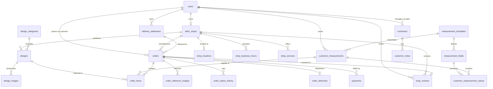

# Project Status and Module Inventory
**ThreadCraft — Multi-Vendor Tailor Marketplace & Shop Management System**

> **Document Type:** Architectural Review, Code Audit & Module Inventory  
> **Mode:** Read-Only Verification (Observed from actual workspace code and configurations)  
> **Date of Audit:** October 2026  
> **Repository:** `multi vendor web`  
> **Status:** Production-Ready Foundation with Selected Modules in Mock/Development Mode  

---

## 1. Project Overview and Technology Stack

### 1.1 Project Overview
**ThreadCraft** is a full-stack, multi-vendor web application platform designed for bespoke tailors, couture ateliers, and bespoke tailoring customers. The platform provides:
- A public discovery marketplace for master cutters, specialty tailoring ateliers, and lookbook designs.
- A dedicated **Customer Dashboard** for managing made-to-measure anatomical measurement profiles, booking bespoke commissions, tracking multi-stage artisan garment production, and monitoring courier delivery.
- A dedicated **Tailor Atelier Dashboard** for managing storefront profiles, lookbook designs, private patron customer directories with fitting observations, and workshop production queues.
- An **Admin Dashboard** for overseeing platform-wide metrics (GMV, orders, active ateliers), approving new tailor storefronts, managing accounts, overriding order lifecycles, and moderating customer reviews.

---

### 1.2 Technology Stack

#### Frontend Application (`/frontend`)
| Layer | Technology | Version (from `package.json`) | Purpose / Code Evidence |
| :--- | :--- | :--- | :--- |
| **Core Framework** | React | `^19.2.8` | Component architecture, context providers, hooks |
| **DOM Engine** | React DOM | `^19.2.8` | Client-side DOM rendering |
| **Build Tooling** | Vite | `^8.3.0` | Fast HMR, ESM bundling, proxy configuration |
| **Language** | TypeScript | `~6.0.2` | Static typing across components, models, and services |
| **Routing** | React Router DOM | `^7.18.4` | Declarative routing with public and role-protected layout shells |
| **Styling** | Tailwind CSS | `^3.4.19` | Custom sartorial theme, dark/light mode classes, glassmorphism |
| **CSS Preprocessor** | PostCSS / Autoprefixer | `^8.5.29` / `^10.6.1` | CSS post-processing pipeline |
| **Iconography** | Lucide React | `^1.53.0` | Modern vector iconography throughout UI |
| **Linter** | Oxlint | `^1.81.0` | Fast JavaScript/TypeScript linter |
| **Internationalization** | Custom `I18nProvider` | Custom (In-tree) | Multi-language translation (`en`, `te`, `hi`) with `localStorage` persistence |
| **Theming** | Custom `ThemeProvider` | Custom (In-tree) | Dark / Light theme toggle with HTML class manipulation and `localStorage` persistence |

#### Backend Application (`/backend`)
| Layer | Technology | Version (from `requirements.txt`) | Purpose / Code Evidence |
| :--- | :--- | :--- | :--- |
| **API Framework** | FastAPI | `>=0.115.0` | High-performance asynchronous REST API framework |
| **ASGI Server** | Uvicorn (`standard`) | `>=0.30.0` | ASGI web server running on `http://127.0.0.1:8000` |
| **Data Validation** | Pydantic / Pydantic Settings | `>=2.8.0` / `>=2.4.0` | Request payload validation, response serialization, settings management |
| **ORM / Data Access** | SQLAlchemy | `>=2.0.30` | Declarative models, relationship mapping, session management |
| **Database Driver** | Psycopg2-binary | `>=2.9.9` | PostgreSQL connection adapter |
| **Migrations** | Alembic | `>=1.13.0` | Database migration framework (Configuration present in `alembic.ini`) |
| **Authentication & Security** | PyJWT / Bcrypt | `>=2.8.0` / `>=4.0.0` | HS256 JWT access tokens, salted password hashing |
| **Input Validation** | Email-validator | `>=2.0.0` | RFC-compliant email verification |
| **HTTP Client** | HTTPX | `>=0.27.0` | Async HTTP requests and integration test client |
| **Environment** | Python-dotenv | `>=1.0.0` | `.env` file parsing |

#### Database & Persistence Architecture
- **Configured Target Database:** PostgreSQL (`postgresql+psycopg2://...`), configurable via `DATABASE_URL` or individual `POSTGRES_*` environment parameters.
- **Development Fallback Mechanism:** Implemented in `backend/app/database/session.py`. If PostgreSQL is offline or unreachable, the application automatically catches the exception and connects to a local SQLite database (`sqlite:///./tailor_marketplace_dev.db`), ensuring zero downtime during local development and testing.
- **Runtime Schema Synchronization:** `sync_database_columns(engine)` dynamically verifies and adds missing international columns (`country`, `currency`, `postal_code`, etc.) on startup across PostgreSQL and SQLite.

---

## 2. Frontend Pages and Modules

### 2.1 Public Marketplace Pages (`frontend/src/pages/public/`)
| Page Name | Route Path | File Path | Status / Evidence | Key Features |
| :--- | :--- | :--- | :--- | :--- |
| **Home** | `/` | `frontend/src/pages/public/HomePage.tsx` | Fully Implemented | Sartorial hero section, category lookbooks, featured master cutters, trending lookbook gallery, trust badges, customer reviews carousel |
| **Find Tailors** | `/tailors` | `frontend/src/pages/public/FindTailorsPage.tsx` | Fully Implemented | Artisan directory with search, specialty filtering, city filter, star rating filter, radius filter, and consultation booking modal |
| **Tailor Registration** | `/register-tailor` | `frontend/src/pages/public/TailorRegistrationPage.tsx` | Fully Implemented | 3-step onboarding flow for tailors: Studio info, master cutter credentials, craftsmanship charter agreement |
| **Sign In** | `/login` | `frontend/src/pages/public/LoginPage.tsx` | Fully Implemented | Email/password login with role selection and 1-click demo account shortcuts for Customer, Master Tailor, and Admin |
| **Registration** | `/register` | `frontend/src/pages/public/RegisterPage.tsx` | Fully Implemented | Customer signup with international dial code selection, address details, password strength meter, and auto-login |
| **About Us** | `/about` | `frontend/src/pages/public/AboutPage.tsx` | Fully Implemented | ThreadCraft atelier narrative, 4 artisan pillars, quality certifications, craftsmanship standards |
| **Services** | `/services` | `frontend/src/pages/public/ServicesPage.tsx` | Fully Implemented | Bespoke disciplines (suits, bridal couture, alterations, doorstep measuring, fabric sourcing) |
| **Contact** | `/contact` | `frontend/src/pages/public/ContactPage.tsx` | Fully Implemented | Concierge message dispatch form, FAQ accordion, global flagship atelier directory |

---

### 2.2 Customer Dashboard Pages (`frontend/src/pages/dashboard/customer/`)
Protected by `<ProtectedRoute allowedRoles={['CUSTOMER']}>` mounted under `/dashboard/customer`.

| Page Name | Route Path | File Path | Status / Evidence | Key Features |
| :--- | :--- | :--- | :--- | :--- |
| **Customer Overview** | `/dashboard/customer` | `frontend/src/pages/dashboard/customer/CustomerDashboardPage.tsx` | Fully Implemented | Wardrobe summary, live commission status chips, quick actions, recommended nearby ateliers |
| **Nearby Tailors** | `/dashboard/customer/nearby` | `frontend/src/pages/dashboard/customer/CustomerNearbyTailorsPage.tsx` | Fully Implemented | HTML5 Geolocation API, radius adjustment slider (5km–100km), radar map visualizer, distance sorting, consultation booking modal |
| **My Measurements** | `/dashboard/customer/measurements` | `frontend/src/pages/dashboard/customer/CustomerMeasurementsPage.tsx` | Fully Implemented | Garment-specific measurement management (Shirt, Pants, Blouse, Dress, Lehenga, Suit, Kids Wear), dynamic input fields loaded from backend templates, unit conversion (cm/inches) |
| **My Orders** | `/dashboard/customer/orders` | `frontend/src/pages/dashboard/customer/CustomerOrdersPage.tsx` | Fully Implemented | Commission tracking, status filter tabs (All, Active, Completed, Cancelled), `CreateOrderModal` (3-step wizard), `OrderDetailsModal` with delivery tracking |
| **Customer Profile** | `/dashboard/customer/profile` | `frontend/src/pages/dashboard/customer/CustomerProfilePage.tsx` | Fully Implemented | 32-point digital anatomical measurement sheet with anatomical diagrams, unit toggle (cm/in), delivery address manager |

---

### 2.3 Tailor Atelier Dashboard Pages (`frontend/src/pages/dashboard/tailor/`)
Protected by `<ProtectedRoute allowedRoles={['TAILOR']}>` mounted under `/dashboard/tailor`.

| Page Name | Route Path | File Path | Status / Evidence | Key Features |
| :--- | :--- | :--- | :--- | :--- |
| **Atelier Overview** | `/dashboard/tailor` | `frontend/src/pages/dashboard/tailor/TailorDashboardPage.tsx` | Fully Implemented | Workshop operations desk, daily fitting appointments, production queue summaries, revenue metrics |
| **Storefront Profile** | `/dashboard/tailor/profile` | `frontend/src/pages/dashboard/tailor/TailorShopProfilePage.tsx` | Fully Implemented | Storefront profile editor, operating business hours, bespoke service offerings, real-time marketplace card preview |
| **Patron Directory** | `/dashboard/tailor/customers` | `frontend/src/pages/dashboard/tailor/TailorCustomersPage.tsx` | Fully Implemented | Multi-tenant customer directory, search and status filtering, profile view drawer, atelier notes storage and chronological log, add patron modal |
| **Lookbook Designs** | `/dashboard/tailor/designs` | `frontend/src/pages/dashboard/tailor/TailorDesignsPage.tsx` | Fully Implemented | Design portfolio manager, category filters, publish new bespoke design modal with fabric and pricing specs |
| **Workshop Orders** | `/dashboard/tailor/orders` | `frontend/src/pages/dashboard/tailor/TailorOrdersPage.tsx` | Fully Implemented | Workshop production queue, milestone advancement controls (11 states), customer contact view, courier dispatch & tracking editor |
| **Atelier Settings** | `/dashboard/tailor/settings` | `frontend/src/pages/dashboard/tailor/TailorSettingsPage.tsx` | Fully Implemented | Production lead times, rush order surcharges, notification preferences |

---

### 2.4 Admin Dashboard Pages (`frontend/src/pages/dashboard/admin/`)
Protected by `<ProtectedRoute allowedRoles={['ADMIN']}>` mounted under `/dashboard/admin`.

| Page Name | Route Path | File Path | Status / Evidence | Key Features |
| :--- | :--- | :--- | :--- | :--- |
| **Admin Console** | `/dashboard/admin` | `frontend/src/pages/dashboard/admin/AdminDashboardPage.tsx` | Fully Implemented | Platform GMV & revenue metrics, active atelier approvals queue, tailor account activation/verification, customer management, global order lifecycle override, review moderation and deletion |

---

### 2.5 Reusable Component Library & Layouts
- **Layouts (`frontend/src/layouts/`):**
  - `PublicLayout.tsx`: Header (`Navbar`), main content container, and footer (`Footer`).
  - `DashboardLayout.tsx`: Sidebar navigation (`Sidebar`), top bar with breadcrumbs, role indicator, language selector (`LanguageSwitcher`), theme toggle (`ThemeToggle`), and profile dropdown.
- **Common Components (`frontend/src/components/common/`):**
  - `Button.tsx`: Variants (`primary`, `secondary`, `outline`, `ghost`, `danger`), loading spinners, icon placement.
  - `Card.tsx`: Standard container card and `StatCard` with trend metrics.
  - `FormFields.tsx`: Form inputs (`Input`, `Textarea`, `Select`, `Checkbox`) with error states and helper texts.
  - `Modal.tsx`: Accessible dialog with backdrop blur, keyboard escape listener, and smooth animations.
  - `SearchBar.tsx`: Search input with clear button and debounce callback.
  - `FeedbackStates.tsx`: `LoadingSpinner`, `SkeletonCard`, `EmptyState`, and `ErrorState` components.
  - `ThemeToggle.tsx`: Dark/light toggle with smooth transition and icon indicator.
  - `ProtectedRoute.tsx`: Authorization wrapper validating session and role against `allowedRoles`.
- **Shared Components (`frontend/src/components/shared/`):**
  - `TailorCard.tsx`: Marketplace atelier storefront preview card with specialty tags, rating, and distance.
  - `DesignCard.tsx`: Lookbook garment card with price estimates, fabric specs, and commission trigger.
  - `OrderCard.tsx`: Order summary card with production progress bar and status badge.
  - `CreateOrderModal.tsx`: 3-step order wizard (Design selection -> Measurements & Reference Upload -> Delivery Address & Pricing Review).
  - `OrderDetailsModal.tsx`: Comprehensive order detail view with multi-milestone timeline, reference image gallery, financial ledger, and manual courier tracking editor.
  - `BookAppointmentModal.tsx`: In-person or virtual consultation scheduler.
- **Internationalization (`frontend/src/i18n/`):**
  - `I18nProvider`: Custom Context provider managing current language (`en`, `te`, `hi`), persisting choice in `localStorage`.
  - Locales: `frontend/src/i18n/locales/en.json`, `te.json`, `hi.json` with fallback resolution to English.

---

## 3. Backend API Endpoints and Their Purpose

The FastAPI backend exposes all routes with the primary prefix `/api` and mirrors them at the root (`/`) for backwards compatibility (`backend/app/main.py:99-100`).

### 3.1 Health & Diagnostics (`/api/health`)
| HTTP Method | Route | Handler / Location | Summary & Purpose | Auth / Role |
| :--- | :--- | :--- | :--- | :--- |
| `GET` | `/api/health` | `health.py:health_check` | Basic ping confirming API service is running. | Public |
| `GET` | `/api/health/detailed` | `health.py:detailed_health_check` | Detailed system diagnostics: database connectivity, dialect, database host, settings. | Public |

---

### 3.2 Authentication & User Profiles (`/api/auth`)
| HTTP Method | Route | Handler / Location | Summary & Purpose | Auth / Role |
| :--- | :--- | :--- | :--- | :--- |
| `POST` | `/api/auth/register` | `auth.py:register` | Registers a new customer or tailor. Normalizes email, enforces password criteria, hashes passwords with salted bcrypt, creates default customer record. Returns JWT token. | Public (Rate-limited) |
| `POST` | `/api/auth/login` | `auth.py:login` | Authenticates credentials, validates active account status, issues signed JWT access token. | Public (Rate-limited) |
| `GET` | `/api/auth/me` | `auth.py:get_current_user_profile` | Retrieves profile of currently authenticated user. | Bearer Token |
| `PUT` | `/api/auth/me` | `auth.py:update_current_user_profile` | Updates profile fields: full name, phone, city, shop name, experience, specialties, country, currency. | Bearer Token |
| `POST` | `/api/auth/logout` | `auth.py:logout` | Revokes the current JWT bearer token by adding it to the in-memory token blacklist (`_revoked_tokens`). | Bearer Token |
| `GET` | `/api/auth/protected/customer` | `auth.py:customer_only_route` | Verification route testing Customer role authorization. | Role: `CUSTOMER` |
| `GET` | `/api/auth/protected/tailor` | `auth.py:tailor_only_route` | Verification route testing Tailor role authorization. | Role: `TAILOR` |
| `GET` | `/api/auth/protected/admin` | `auth.py:admin_only_route` | Verification route testing Admin role authorization. | Role: `ADMIN` |

---

### 3.3 Tailor Discovery (`/api/tailors`)
| HTTP Method | Route | Handler / Location | Summary & Purpose | Auth / Role |
| :--- | :--- | :--- | :--- | :--- |
| `GET` | `/api/tailors/nearby` | `tailor_discovery.py:get_nearby_tailors` | Discovers tailor shops using customer GPS coordinates (`latitude`, `longitude`) and radius in km. Calculates great-circle distances and returns shops sorted by proximity. | Public |

---

### 3.4 Tailor Customer Management (`/api/tailors/customers`)
| HTTP Method | Route | Handler / Location | Summary & Purpose | Auth / Role |
| :--- | :--- | :--- | :--- | :--- |
| `POST` | `/api/tailors/customers` | `tailor_customers.py:create_customer` | Adds a new patron customer under the tailor's atelier. | Role: `TAILOR` |
| `GET` | `/api/tailors/customers` | `tailor_customers.py:list_customers` | Retrieves paginated customers belonging exclusively to the tailor, with search across name/email/phone/city and status filtering. | Role: `TAILOR` |
| `GET` | `/api/tailors/customers/{id}` | `tailor_customers.py:get_customer` | Retrieves detailed customer profile, order history, and notes history. | Role: `TAILOR` |
| `PUT` | `/api/tailors/customers/{id}` | `tailor_customers.py:update_customer` | Updates existing customer profile details. Enforces tailor tenant ownership. | Role: `TAILOR` |
| `DELETE` | `/api/tailors/customers/{id}` | `tailor_customers.py:delete_customer` | Deletes customer profile and cascade deletes all associated atelier notes. | Role: `TAILOR` |
| `POST` | `/api/tailors/customers/{id}/notes` | `tailor_customers.py:add_customer_note` | Stores a new atelier fitting note or observation for a customer. | Role: `TAILOR` |
| `GET` | `/api/tailors/customers/{id}/notes` | `tailor_customers.py:list_customer_notes` | Retrieves chronological atelier notes for a customer. | Role: `TAILOR` |
| `DELETE` | `/api/tailors/customers/{id}/notes/{note_id}` | `tailor_customers.py:delete_customer_note` | Deletes a specific atelier note from a customer's record. | Role: `TAILOR` |

---

### 3.5 Garment Measurement Management
Mounted under `/api/measurement-templates` and `/api/customers/measurements`.

| HTTP Method | Route | Handler / Location | Summary & Purpose | Auth / Role |
| :--- | :--- | :--- | :--- | :--- |
| `GET` | `/api/measurement-templates` | `measurements.py:list_measurement_templates` | Lists all garment templates (Shirt, Pants, Blouse, Dress, Lehenga, Suit, Kids Wear). | Public |
| `GET` | `/api/measurement-templates/{id}` | `measurements.py:get_measurement_template` | Returns a specific garment template with ordered anatomical measurement fields, units, and min/max ranges. | Public |
| `POST` | `/api/customers/measurements` | `measurements.py:create_customer_measurement` | Creates and persists a customer measurement profile based on a template, validating all numeric field values against constraints. | Bearer Token (`CUSTOMER`) |
| `GET` | `/api/customers/measurements` | `measurements.py:list_customer_measurements` | Retrieves all saved measurement profiles belonging to the authenticated customer. | Bearer Token (`CUSTOMER`) |
| `GET` | `/api/customers/measurements/{id}` | `measurements.py:get_customer_measurement` | Retrieves a specific customer measurement profile with values and field labels. | Bearer Token (`CUSTOMER`) |
| `PUT` | `/api/customers/measurements/{id}` | `measurements.py:update_customer_measurement` | Updates an existing customer measurement profile. Enforces customer ownership. | Bearer Token (`CUSTOMER`) |
| `DELETE` | `/api/customers/measurements/{id}` | `measurements.py:delete_customer_measurement` | Deletes a customer measurement profile and cascade deletes associated values. | Bearer Token (`CUSTOMER`) |

---

### 3.6 Online Orders & Production Stages
Mounted under `/api/orders` (customer operations) and `/api/tailors/orders` (tailor operations).

| HTTP Method | Route | Handler / Location | Summary & Purpose | Auth / Role |
| :--- | :--- | :--- | :--- | :--- |
| `POST` | `/api/orders` | `orders.py:create_order` | Places a bespoke order. Validates design, measurement profile, delivery address, calculates pricing server-side, generates order number. | Role: `CUSTOMER` |
| `GET` | `/api/orders` | `orders.py:get_customer_orders` | Retrieves all bespoke orders placed by the authenticated customer. | Role: `CUSTOMER` |
| `GET` | `/api/orders/{id}` | `orders.py:get_customer_order_by_id` | Retrieves comprehensive order details (items, measurements, reference images, delivery, history). | Role: `CUSTOMER` |
| `POST` | `/api/orders/{id}/reference-images` | `orders.py:upload_order_reference_image` | Uploads style inspiration photo or attaches URL. Performs MIME check, 5MB size limit check, and magic-byte verification. | Customer or Tailor owner |
| `GET` | `/api/orders/{id}/status-history` | `orders.py:get_order_status_history` | Retrieves chronological audit log of production stage milestones. | Order owner or Tailor |
| `PUT` | `/api/orders/{id}/status` | `orders.py:update_order_status` | Advances order status according to the 11-stage state machine transition rules. | Order owner or Tailor |
| `GET` | `/api/orders/{id}/delivery` | `orders.py:get_order_delivery` | Retrieves courier tracking details, dispatch status, and expected delivery date. | Order owner, Tailor, Admin |
| `PUT` / `POST`| `/api/orders/{id}/delivery` | `orders.py:update_order_delivery` | Updates manual courier dispatch, tracking number, status, and expected delivery date. | Tailor owner or Admin |
| `GET` | `/api/tailors/orders` | `orders.py:get_tailor_orders` | Retrieves all incoming and in-progress commissions for the tailor's atelier. | Role: `TAILOR` |
| `GET` | `/api/tailors/orders/{id}` | `orders.py:get_tailor_order_by_id` | Retrieves complete order details under the tailor's atelier. | Role: `TAILOR` |
| `GET` | `/api/tailors/orders/{id}/delivery` | `orders.py:get_tailor_order_delivery` | Retrieves delivery details for an atelier order. | Role: `TAILOR` |
| `PUT` / `POST`| `/api/tailors/orders/{id}/delivery` | `orders.py:update_tailor_order_delivery` | Updates courier dispatch and tracking info for an atelier order. | Role: `TAILOR` |

---

### 3.7 Design Lookbooks (`/api/designs`)
| HTTP Method | Route | Handler / Location | Summary & Purpose | Auth / Role |
| :--- | :--- | :--- | :--- | :--- |
| `GET` | `/api/designs` | `orders.py:list_designs` | Lists active lookbook designs with pricing and fabric specifications. Optional `shop_id` filter. | Public |
| `GET` | `/api/designs/{id}` | `orders.py:get_design_by_id` | Retrieves detailed specifications of a single design. | Public |

---

### 3.8 Internationalization & Utilities (`/api/international`)
| HTTP Method | Route | Handler / Location | Summary & Purpose | Auth / Role |
| :--- | :--- | :--- | :--- | :--- |
| `GET` | `/api/international/countries` | `international.py:list_countries` | Lists supported global jurisdictions (India, US, UK, UAE, Canada, Australia, Singapore, Germany, France) with dial codes, currencies, postal patterns. | Public |
| `GET` | `/api/international/currencies` | `international.py:list_currencies` | Lists supported billing currencies (INR, USD, GBP, EUR, AED, CAD, AUD, SGD) with exchange rates and delivery fees. | Public |
| `POST` | `/api/international/validate-phone` | `international.py:validate_phone` | Validates international or domestic phone numbers based on country format. | Public |
| `POST` | `/api/international/validate-address` | `international.py:validate_address` | Validates international shipping destination fields and postal code regex. | Public |

---

### 3.9 Payment Integration (`/api/payments`)
| HTTP Method | Route | Handler / Location | Summary & Purpose | Auth / Role |
| :--- | :--- | :--- | :--- | :--- |
| `GET` | `/api/payments/config` | `payments.py:get_payment_config` | Returns public gateway provider parameters and supported methods without exposing secrets. | Public |
| `POST` | `/api/payments/intent` | `payments.py:create_payment_intent` | Initiates payment intent for an order. Amount is strictly calculated server-side from order items. | Bearer Token |
| `POST` | `/api/payments/confirm` | `payments.py:confirm_payment` | Confirms transaction completion and updates order payment status to `PAID`. | Bearer Token |
| `GET` | `/api/payments/order/{order_id}` | `payments.py:get_order_payments` | Retrieves chronological payment records for an order. | Customer, Tailor, Admin |

---

### 3.10 Customer Reviews (`/api/reviews`)
| HTTP Method | Route | Handler / Location | Summary & Purpose | Auth / Role |
| :--- | :--- | :--- | :--- | :--- |
| `POST` | `/api/reviews` | `reviews.py:create_review` | Submits a 1-5 star review for a completed order. Enforces order completion and uniqueness (strictly 1 review per completed order). | Role: `CUSTOMER` |
| `GET` | `/api/reviews/shop/{shop_id}` | `reviews.py:get_shop_reviews` | Returns aggregated rating, star distribution, and verified customer reviews for a tailor atelier. | Public |
| `GET` | `/api/reviews/order/{order_id}` | `reviews.py:get_order_review` | Fetches the review submitted for a specific order. | Bearer Token |
| `PUT` | `/api/reviews/{id}` | `reviews.py:update_review` | Updates rating or commentary for a submitted review. Enforces ownership. | Bearer Token (`CUSTOMER`) |
| `DELETE` | `/api/reviews/{id}` | `reviews.py:delete_review` | Removes a customer review and recalculates shop average rating. | Bearer Token (`CUSTOMER`) |

---

### 3.11 Admin Operations (`/api/admin`)
All endpoints in this group require the `ADMIN` role (`admin.py:19`).

| HTTP Method | Route | Handler / Location | Summary & Purpose | Auth / Role |
| :--- | :--- | :--- | :--- | :--- |
| `GET` | `/api/admin/dashboard/stats` | `admin.py:get_dashboard_stats` | Returns platform aggregate metrics: total customers, total tailors, total shops, total orders, pending shop approvals, completed volume. | Role: `ADMIN` |
| `GET` | `/api/admin/tailors` | `admin.py:list_tailors` | Lists tailor accounts with search, active filter, and pagination. | Role: `ADMIN` |
| `PUT` | `/api/admin/tailors/{id}/status` | `admin.py:update_tailor_status` | Updates tailor account status (activate, deactivate, verify). | Role: `ADMIN` |
| `GET` | `/api/admin/customers` | `admin.py:list_customers` | Lists customer accounts with search, active filter, country filter, and pagination. | Role: `ADMIN` |
| `PUT` | `/api/admin/customers/{id}/status` | `admin.py:update_customer_status` | Updates customer account active state. | Role: `ADMIN` |
| `GET` | `/api/admin/shops` | `admin.py:list_shops` | Lists tailor atelier shops with approval state and search. | Role: `ADMIN` |
| `PUT` | `/api/admin/shops/{id}/status` | `admin.py:update_shop_status` | Approves or suspends tailor storefront. | Role: `ADMIN` |
| `GET` | `/api/admin/orders` | `admin.py:list_orders` | Lists all platform orders with search, status filters, shop filter, and pagination. | Role: `ADMIN` |
| `PUT` | `/api/admin/orders/{id}/status` | `admin.py:update_order_status` | Administrative override of order status with audit trail notes. | Role: `ADMIN` |
| `GET` | `/api/admin/reviews` | `admin.py:list_reviews` | Lists all reviews across shops with moderation filtering. | Role: `ADMIN` |
| `DELETE` | `/api/admin/reviews/{id}` | `admin.py:delete_review` | Permanently deletes an inappropriate review. | Role: `ADMIN` |

---

## 4. Database Models and Relationships

All persistent entities inherit from `Base` (SQLAlchemy declarative base) and `TimestampMixin` (`id`, `created_at`, `updated_at`):



### 4.1 Detailed Model Inventory

| Model Class | DB Table Name | File Location | Key Columns & Types | Foreign Keys & Constraints | Relationships |
| :--- | :--- | :--- | :--- | :--- | :--- |
| **`User`** | `users` | `backend/app/models/user.py` | `id` (PK, Int)<br>`email` (Str 255, Unique, Index)<br>`hashed_password` (Str 255)<br>`full_name` (Str 255)<br>`role` (Str 50, Index: CUSTOMER, TAILOR, ADMIN)<br>`phone` (Str 50)<br>`country` (Str 100)<br>`currency` (Str 10)<br>`is_active` (Bool)<br>`is_verified` (Bool)<br>`shop_name` (Str 255)<br>`city` (Str 100)<br>`experience_years` (Int)<br>`specialties` (Str 500) | `email` Unique Index | `shop` -> `TailorShop` (1:1, cascade delete) |
| **`Customer`** | `customers` | `backend/app/models/customer.py` | `id` (PK, Int)<br>`tailor_id` (Int, FK)<br>`shop_id` (Int)<br>`shop_name` (Str 255)<br>`full_name` (Str 255, Index)<br>`email` (Str 255)<br>`phone` (Str 50)<br>`gender` (Str 50)<br>`address` (Str 255)<br>`city` (Str 100)<br>`state` (Str 100)<br>`pincode` (Str 50)<br>`country` (Str 100)<br>`country_code` (Str 10)<br>`currency` (Str 10)<br>`status` (Str 50: ACTIVE/INACTIVE)<br>`total_orders` (Int)<br>`total_spend` (Float) | `tailor_id` -> `users.id` (ON DELETE CASCADE) | `tailor` -> `User`<br>`notes` -> `CustomerNote` (1:N, cascade delete) |
| **`CustomerNote`** | `customer_notes` | `backend/app/models/customer.py` | `id` (PK, Int)<br>`customer_id` (Int, FK)<br>`tailor_id` (Int, FK)<br>`note` (Text)<br>`category` (Str 50: GENERAL, FITTING, FABRIC, ALTERATION) | `customer_id` -> `customers.id`<br>`tailor_id` -> `users.id` | `customer` -> `Customer`<br>`tailor` -> `User` |
| **`TailorShop`** | `tailor_shops` | `backend/app/models/shop.py` | `id` (PK, Int)<br>`user_id` (Int, FK, Unique)<br>`shop_name` (Str 255, Index)<br>`owner_name` (Str 255)<br>`phone` (Str 50)<br>`email` (Str 255)<br>`description` (Text)<br>`is_active` (Bool)<br>`rating` (Float, default 4.9)<br>`review_count` (Int)<br>`profile_image` (Str 500)<br>`cover_image` (Str 500)<br>`experience_years` (Int)<br>`specialties` (Str 500)<br>`starting_price` (Float)<br>`turnaround_days` (Int) | `user_id` -> `users.id` (ON DELETE CASCADE) | `user` -> `User`<br>`location` -> `ShopLocation` (1:1)<br>`business_hours` -> `ShopBusinessHour` (1:N)<br>`services` -> `ShopService` (1:N)<br>`designs` -> `Design` (1:N)<br>`reviews` -> `ShopReview` (1:N) |
| **`ShopLocation`** | `shop_locations` | `backend/app/models/shop.py` | `id` (PK, Int)<br>`shop_id` (Int, FK, Unique)<br>`country` (Str 100)<br>`state` (Str 100)<br>`city` (Str 100, Index)<br>`district` (Str 100)<br>`address` (Str 255)<br>`pincode` (Str 50)<br>`latitude` (Float, Index)<br>`longitude` (Float, Index) | `shop_id` -> `tailor_shops.id` (ON DELETE CASCADE) | `shop` -> `TailorShop` |
| **`ShopBusinessHour`**| `shop_business_hours` | `backend/app/models/shop.py` | `id` (PK, Int)<br>`shop_id` (Int, FK)<br>`day_of_week` (Str 20)<br>`open_time` (Str 10)<br>`close_time` (Str 10)<br>`is_closed` (Bool) | `shop_id` -> `tailor_shops.id` (ON DELETE CASCADE) | `shop` -> `TailorShop` |
| **`ShopService`** | `shop_services` | `backend/app/models/shop.py` | `id` (PK, Int)<br>`shop_id` (Int, FK)<br>`service_name` (Str 150)<br>`description` (Text)<br>`starting_price` (Float)<br>`turnaround_days` (Int)<br>`category` (Str 100)<br>`is_available` (Bool) | `shop_id` -> `tailor_shops.id` (ON DELETE CASCADE) | `shop` -> `TailorShop` |
| **`DesignCategory`** | `design_categories` | `backend/app/models/design.py` | `id` (PK, Int)<br>`name` (Str 100)<br>`slug` (Str 100, Unique, Index)<br>`description` (Str 255) | `slug` Unique Index | `designs` -> `Design` (1:N) |
| **`Design`** | `designs` | `backend/app/models/design.py` | `id` (PK, Int)<br>`shop_id` (Int, FK)<br>`category_id` (Int, FK)<br>`title` (Str 255, Index)<br>`description` (Text)<br>`price_from` (Float)<br>`price_to` (Float)<br>`fabric` (Str 255)<br>`customization_available` (Bool)<br>`is_active` (Bool)<br>`image_url` (Str 500)<br>`tags` (Str 500) | `shop_id` -> `tailor_shops.id`<br>`category_id` -> `design_categories.id` | `shop` -> `TailorShop`<br>`category` -> `DesignCategory`<br>`images` -> `DesignImage` (1:N) |
| **`DesignImage`** | `design_images` | `backend/app/models/design.py` | `id` (PK, Int)<br>`design_id` (Int, FK)<br>`image_url` (Str 500)<br>`is_primary` (Bool)<br>`display_order` (Int) | `design_id` -> `designs.id` (ON DELETE CASCADE) | `design` -> `Design` |
| **`MeasurementTemplate`** | `measurement_templates` | `backend/app/models/measurement.py` | `id` (PK, Int)<br>`garment_type` (Str 100, Unique, Index)<br>`name` (Str 150)<br>`description` (Text) | `garment_type` Unique Index | `fields` -> `MeasurementField` (1:N)<br>`measurements` -> `CustomerMeasurement` (1:N) |
| **`MeasurementField`** | `measurement_fields` | `backend/app/models/measurement.py` | `id` (PK, Int)<br>`template_id` (Int, FK)<br>`field_name` (Str 100)<br>`field_label` (Str 150)<br>`unit` (Str 50)<br>`required` (Bool)<br>`display_order` (Int)<br>`min_value` (Float)<br>`max_value` (Float)<br>`description` (Str 255) | `template_id` -> `measurement_templates.id` (ON DELETE CASCADE) | `template` -> `MeasurementTemplate`<br>`values` -> `CustomerMeasurementValue` (1:N) |
| **`CustomerMeasurement`** | `customer_measurements` | `backend/app/models/measurement.py` | `id` (PK, Int)<br>`customer_id` (Int, FK)<br>`tailor_shop_id` (Int, FK, Nullable)<br>`template_id` (Int, FK)<br>`measurement_name` (Str 255, Index)<br>`unit` (Str 20: inches/cm)<br>`notes` (Text) | `customer_id` -> `users.id`<br>`tailor_shop_id` -> `tailor_shops.id`<br>`template_id` -> `measurement_templates.id` | `customer` -> `User`<br>`tailor_shop` -> `TailorShop`<br>`template` -> `MeasurementTemplate`<br>`values` -> `CustomerMeasurementValue` (1:N) |
| **`CustomerMeasurementValue`** | `customer_measurement_values` | `backend/app/models/measurement.py` | `id` (PK, Int)<br>`measurement_id` (Int, FK)<br>`field_id` (Int, FK)<br>`value` (Float) | `measurement_id` -> `customer_measurements.id`<br>`field_id` -> `measurement_fields.id` | `measurement` -> `CustomerMeasurement`<br>`field` -> `MeasurementField` |
| **`DeliveryAddress`** | `delivery_addresses` | `backend/app/models/order.py` | `id` (PK, Int)<br>`customer_id` (Int, FK)<br>`full_name` (Str 150)<br>`phone` (Str 50)<br>`address_line_1` (Str 255)<br>`address_line_2` (Str 255)<br>`city` (Str 100, Index)<br>`state` (Str 100)<br>`country` (Str 100)<br>`country_code` (Str 10)<br>`pincode` (Str 50)<br>`postal_code` (Str 50)<br>`latitude` (Float)<br>`longitude` (Float) | `customer_id` -> `users.id` (ON DELETE CASCADE) | `customer` -> `User`<br>`orders` -> `Order` (1:N) |
| **`Order`** | `orders` | `backend/app/models/order.py` | `id` (PK, Int)<br>`order_number` (Str 64, Unique, Index)<br>`customer_id` (Int, FK)<br>`tailor_shop_id` (Int, FK)<br>`delivery_address_id` (Int, FK)<br>`status` (Str 50, Index)<br>`payment_status` (Str 50: UNPAID/PAID)<br>`subtotal` (Float)<br>`delivery_charge` (Float)<br>`total_amount` (Float)<br>`currency` (Str 10)<br>`customer_notes` (Text) | `order_number` Unique<br>`customer_id` -> `users.id`<br>`tailor_shop_id` -> `tailor_shops.id`<br>`delivery_address_id` -> `delivery_addresses.id` | `customer` -> `User`<br>`tailor_shop` -> `TailorShop`<br>`delivery_address` -> `DeliveryAddress`<br>`items` -> `OrderItem` (1:N)<br>`reference_images` -> `OrderReferenceImage` (1:N)<br>`status_history` -> `OrderStatusHistory` (1:N)<br>`delivery` -> `OrderDelivery` (1:1)<br>`payments` -> `Payment` (1:N)<br>`review` -> `ShopReview` (1:1) |
| **`OrderItem`** | `order_items` | `backend/app/models/order.py` | `id` (PK, Int)<br>`order_id` (Int, FK)<br>`design_id` (Int, FK)<br>`item_title` (Str 255)<br>`quantity` (Int)<br>`unit_price` (Float)<br>`customization_notes` (Text)<br>`measurement_id` (Int, FK) | `order_id` -> `orders.id`<br>`design_id` -> `designs.id`<br>`measurement_id` -> `customer_measurements.id` | `order` -> `Order`<br>`design` -> `Design`<br>`measurement` -> `CustomerMeasurement` |
| **`OrderReferenceImage`**| `order_reference_images`| `backend/app/models/order.py` | `id` (PK, Int)<br>`order_id` (Int, FK)<br>`image_url` (Str 500)<br>`created_at` (DateTime) | `order_id` -> `orders.id` (ON DELETE CASCADE) | `order` -> `Order` |
| **`OrderStatusHistory`**| `order_status_history`| `backend/app/models/order.py` | `id` (PK, Int)<br>`order_id` (Int, FK)<br>`status` (Str 50)<br>`changed_by` (Int, FK)<br>`notes` (Text)<br>`created_at` (DateTime) | `order_id` -> `orders.id`<br>`changed_by` -> `users.id` | `order` -> `Order`<br>`user` -> `User` |
| **`OrderDelivery`** | `order_deliveries` | `backend/app/models/delivery.py` | `id` (PK, Int)<br>`order_id` (Int, FK, Unique)<br>`delivery_method` (Str 50)<br>`courier_name` (Str 100)<br>`tracking_number` (Str 100, Index)<br>`tracking_url` (Str 500)<br>`status` (Str 50: PENDING, LABEL_CREATED, SHIPPED, IN_TRANSIT, OUT_FOR_DELIVERY, DELIVERED, FAILED)<br>`expected_delivery_date` (DateTime)<br>`shipped_at` (DateTime)<br>`delivered_at` (DateTime)<br>`notes` (Text) | `order_id` -> `orders.id` (ON DELETE CASCADE) | `order` -> `Order` |
| **`Payment`** | `payments` | `backend/app/models/payment.py` | `id` (PK, Int)<br>`order_id` (Int, FK)<br>`payment_id` (Str 100, Unique, Index)<br>`amount` (Float)<br>`currency` (Str 10)<br>`status` (Str 50: PENDING, COMPLETED, FAILED, REFUNDED)<br>`payment_method` (Str 50: CARD, UPI, NET_BANKING, WALLET, CASH_ON_DELIVERY)<br>`provider` (Str 50: MOCK_SANDBOX)<br>`transaction_reference` (Str 255)<br>`error_message` (Text)<br>`notes` (Text) | `order_id` -> `orders.id` (ON DELETE CASCADE) | `order` -> `Order` |
| **`ShopReview`** | `shop_reviews` | `backend/app/models/review.py` | `id` (PK, Int)<br>`customer_id` (Int, FK)<br>`tailor_shop_id` (Int, FK)<br>`order_id` (Int, FK, Unique)<br>`rating` (Int, 1-5)<br>`comment` (Text) | `customer_id` -> `users.id`<br>`tailor_shop_id` -> `tailor_shops.id`<br>`order_id` -> `orders.id`<br>`chk_review_rating_range`: `rating >= 1 AND rating <= 5`<br>`uq_shop_reviews_order_id`: Unique `order_id` | `customer` -> `User`<br>`tailor_shop` -> `TailorShop`<br>`order` -> `Order` |

---

## 5. Frontend-to-Backend-to-Database Request Flow

### 5.1 Authentication Flow
```
User (Browser) 
  --> Types credentials in LoginPage.tsx
  --> Calls authService.login({ email, password })
  --> Calls apiClient<AuthResponse>('/auth/login')
  --> HTTP POST http://127.0.0.1:8000/api/auth/login
  --> FastAPI router matches endpoint in app/api/v1/endpoints/auth.py
  --> Passes payload to auth_service.authenticate_user(db, login_in)
  --> user_repository queries users table for matching email
  --> bcrypt.checkpw(plain_password, hashed_password)
  --> create_access_token(user.id, user.role) signs JWT token (HS256)
  --> Returns { access_token, token_type: "bearer", user: {...} }
  --> authService stores token in localStorage ('threadcraft_token', 'threadcraft_user')
  --> AuthProvider updates React state, redirects to role dashboard
```

### 5.2 Authenticated Protected Request Flow
```
User navigates to Protected Route (e.g., /dashboard/customer/orders)
  --> ProtectedRoute.tsx checks authState from useAuth()
  --> If unauthenticated, redirects to /login; if unauthorized role, shows 403 Forbidden state
  --> Component invokes orderService.getCustomerOrders()
  --> apiClient('/api/orders') attaches 'Authorization: Bearer <token>'
  --> Dispatches request with 10-second AbortController timeout
  --> FastAPI executes get_current_user dependency (app/api/deps.py)
  --> Extracts HTTPAuthorizationCredentials
  --> Checks if token is in _revoked_tokens blacklist (if revoked -> 401)
  --> Decodes JWT payload using SECRET_KEY & HS256
  --> Extracts user ID 'sub', queries users table in DB session
  --> RoleChecker verifies user.role matches required role (e.g., CUSTOMER)
  --> Handler processes request, queries orders table with customer_id filter
  --> Returns List[OrderResponse] serialized via Pydantic
  --> If 401 occurs, apiClient cleans up stale localStorage session tokens
```

### 5.3 Order Placement Flow (Made-to-Measure Commission)
```
Customer opens CreateOrderModal.tsx
  --> Step 1: Selects lookbook design, quantity, fabric notes, currency
  --> Step 2: Selects saved customer measurement profile (loaded from /api/customers/measurements)
              Uploads optional reference image file or URL
  --> Step 3: Fills international delivery address (full name, phone, address, city, country, postal)
  --> Submits form -> orderService.createOrder(payload)
  --> POST /api/orders with OrderCreate schema
  --> order_service.create_order():
        1. Loads design from DB to get verified price_from (TAMPER-PROOF server-side pricing)
        2. Verifies customer_measurement ownership in customer_measurements table
        3. Creates delivery_addresses record in database
        4. Calculates subtotal = price * quantity, delivery_charge, total_amount
        5. Inserts orders record with unique order_number (e.g., TC-2026-XXXX)
        6. Inserts order_items records linked to design and measurement profile
        7. Inserts order_status_history record (status='PENDING', changed_by=customer.id)
        8. db.commit() commits atomic transaction
  --> If reference image file was attached, uploads via POST /api/orders/{id}/reference-images:
        Checks MIME type, checks 5MB size limit, checks magic-byte signature (\xff\xd8, PNG header, etc.)
        Saves file to backend/app/static/order_references/
        Inserts record in order_reference_images table
  --> Returns OrderResponse to frontend modal
  --> OrderCard updates immediately with progress bar and timeline
```

### 5.4 Order Production & Courier Tracking Flow
```
Tailor opens /dashboard/tailor/orders
  --> TailorOrdersPage calls orderService.getTailorOrders()
  --> GET /api/tailors/orders queries orders where tailor_shop_id == tailor.shop.id
  --> Tailor opens OrderDetailsModal.tsx for an order in 'PENDING' state
  --> Tailor clicks "Accept Commission"
  --> PUT /api/orders/{id}/status with { status: "ACCEPTED", notes: "Accepted by master cutter" }
  --> order_service.update_order_status() validates transition against ALLOWED_TRANSITIONS
  --> Updates orders.status in DB, creates order_status_history entry
  --> Tailor advances through CUTTING -> STITCHING -> QUALITY_CHECK -> READY -> SHIPPED
  --> In 'Delivery & Tracking' section, tailor enters courier name, tracking number, expected date
  --> PUT /api/orders/{id}/delivery with DeliveryCreateOrUpdate payload
  --> Inserts or updates order_deliveries record
  --> Customer opens /dashboard/customer/orders and sees live tracking badge & 1-click copy tracking button
```

---

## 6. Implemented, Partially Implemented, and Missing Features

| Functional Area | Status | Evidence in Codebase | Details & Limitations |
| :--- | :--- | :--- | :--- |
| **Authentication & RBAC** | **Implemented** | `auth.py`, `deps.py`, `security.py`, `useAuth.tsx` | Full email/password login, bcrypt salted hashing, JWT generation, role enforcement (`CUSTOMER`, `TAILOR`, `ADMIN`), in-memory token blacklist for logout. |
| **Tailor Discovery (Location-based)** | **Implemented** | `tailor_discovery.py`, `CustomerNearbyTailorsPage.tsx` | Great-circle distance calculations from GPS coordinates, radius filtering (km), radar map visualizer, sorting by proximity. |
| **Tailor Storefront & Profile** | **Implemented** | `shop.py`, `TailorShopProfilePage.tsx` | Storefront branding, business hours, services, live card preview, and lookbook showcase. |
| **Tailor Customer Management** | **Implemented** | `tailor_customers.py`, `customer_service.py`, `TailorCustomersPage.tsx` | Multi-tenant customer directory isolated per tailor, CRUD operations, chronological fitting observations/notes. |
| **Garment Measurement Profiles** | **Implemented** | `measurements.py`, `CustomerMeasurementsPage.tsx` | 7 garment templates with anatomical fields, min/max range validation, customer profile persistence, unit switching (cm/in). |
| **Online Order Commissioning** | **Implemented** | `orders.py`, `order_service.py`, `CreateOrderModal.tsx` | 3-step commission wizard, server-side tamper-proof pricing, unique order numbers, atomic DB transaction. |
| **Production Milestone Machine** | **Implemented** | `order.py` (`ALLOWED_TRANSITIONS`), `OrderDetailsModal.tsx` | 11-stage state machine (`PENDING` to `DELIVERED`/`CANCELLED`), status history audit logging, tailor stage controls. |
| **Order Reference Photo Upload** | **Implemented** | `orders.py:upload_order_reference_image` | Multipart upload with MIME validation, 5MB ceiling, magic-byte inspection, disk storage in `/static/order_references/`. |
| **Delivery Tracking & Logistics** | **Implemented** | `delivery.py`, `orders.py`, `OrderDetailsModal.tsx` | Courier name, tracking number, tracking status, expected delivery date, 1-click clipboard copying. |
| **Multilingual i18n System** | **Implemented** | `frontend/src/i18n/`, `en.json`, `te.json`, `hi.json` | English, Telugu, and Hindi translations with English key fallback and `localStorage` persistence. |
| **Theme System (Dark / Light)** | **Implemented** | `useTheme.tsx`, `ThemeToggle.tsx`, `index.css` | Class-based dark/light theme switching with smooth transitions and `localStorage` persistence. |
| **Admin Management Console** | **Implemented** | `admin.py`, `admin_service.py`, `AdminDashboardPage.tsx` | Platform GMV metrics, tailor approval, customer activation, global order status overrides, review moderation. |
| **Appointment Booking** | **Partially Implemented** | `appointmentService.ts`, `BookAppointmentModal.tsx` | **Frontend-only mock:** Appointments are saved to browser `localStorage` (`threadcraft_appointments`). **No backend API or database table exists for appointments.** |
| **Payment Gateway Integration** | **Partially Implemented** | `payment.py`, `payments.py`, `payment_service.py` | Backend models, intent calculation, and sandbox confirmation endpoints exist in `MOCK_SANDBOX` mode. **The frontend does not have an active checkout payment modal during order creation; payment_status remains UNPAID.** |
| **Customer Review Submission** | **Partially Implemented** | `review.py`, `reviews.py`, `review_service.py`, `admin.py` | Backend review models, DB constraints (1 review per completed order, 1-5 stars), and admin moderation exist. **The customer dashboard does not have a "Write Review" modal for completed orders.** |
| **International Currency / Live FX** | **Partially Implemented** | `international.py`, `internationalService.ts` | 8 countries and currencies supported with address/phone validation; exchange rates are hardcoded static lookup values rather than live currency feeds. |
| **Alembic Database Migrations** | **Partially Implemented** | `alembic.ini`, `backend/alembic/env.py` | Alembic configuration exists, but `backend/alembic/versions/` is empty. The application currently relies on `Base.metadata.create_all()` and startup column sync. |
| **Live Payment Webhooks** | **Missing** | N/A | No live Stripe/Razorpay/PayPal webhook verification endpoint. |
| **Live Courier Tracking APIs** | **Missing** | N/A | No live shipping carrier API integration (e.g. Shiprocket, Delhivery, DHL API); all tracking is manually entered. |
| **Email / SMS Notifications** | **Missing** | N/A | No notification dispatch service (Twilio, SendGrid, AWS SES) for order status updates or fitting reminders. |

---

## 7. Known Issues and Pending Integrations

### 7.1 Identified Issues & Architecture Gotchas
1. **SQLite Development Fallback vs. PostgreSQL:**
   - When PostgreSQL is offline, the backend silently connects to `sqlite:///./tailor_marketplace_dev.db`. While convenient for local development, data created in SQLite will not be visible when PostgreSQL is started without a manual database dump/migration.
2. **In-Memory JWT Token Revocation:**
   - Token revocation upon logout (`revoke_token()` in `backend/app/core/security.py`) stores revoked tokens in a Python `set` in process memory (`_revoked_tokens`). Restarting the Uvicorn server clears the blacklist, and it cannot scale horizontally across multi-worker instances without Redis.
3. **Frontend Mock Fallback in `orderService.ts`:**
   - `orderService.getCustomerOrders()` and `orderService.getTailorOrders()` fall back to `mockOrders` if the backend returns an empty array or network failure (`orderService.ts:35-37`). This can lead to mock commissions being displayed to real users when no actual orders have been placed yet.
4. **Missing Database Migration History:**
   - The directory `backend/alembic/versions` is completely empty. Changes to database models are not version-controlled via Alembic revisions.
5. **No Gated Payment Step in Order Flow:**
   - Customers can place orders directly, which sets `payment_status="UNPAID"`. Tailors can move the order through production to completion without enforcing payment collection.

### 7.2 Pending Integrations
- **Payment Gateway:** Replace `MOCK_SANDBOX` with live gateway credentials (Stripe Checkout / Razorpay / PayPal), embed payment elements into `CreateOrderModal`, and add server-verified webhook endpoints.
- **Appointment Booking API:** Build `/api/appointments` router and SQLAlchemy model to migrate client-side `localStorage` bookings into persistent database records.
- **Customer Review Submission Interface:** Add a "Rate & Review Atelier" modal triggered when an order reaches `DELIVERED` status.
- **Real-Time Notification Service:** Connect SendGrid or Twilio for order milestone emails and SMS tracking updates.
- **Live Carrier Webhook Integration:** Connect third-party logistics APIs (Shiprocket / Delhivery / DHL) to automatically populate courier tracking status.

---

## 8. Recommended Next Steps

### Priority 1: Production Infrastructure & Migrations
1. **Generate Alembic Baseline Revision:**
   - Run `alembic revision --autogenerate -m "initial_schema"` against the PostgreSQL target to establish version-controlled migration history and remove dependency on runtime `create_all()`.
2. **Implement Redis-Backed Token Blacklist:**
   - Replace in-memory `_revoked_tokens` set with a Redis key-value store with TTL matching `ACCESS_TOKEN_EXPIRE_MINUTES`.
3. **Environment Security Hardening:**
   - Rotate `SECRET_KEY` and ensure all database passwords and credentials are provided strictly via production environment variables rather than development defaults.

### Priority 2: Feature Completions
4. **Backend Appointment Booking Module:**
   - Create `Appointment` SQLAlchemy model with columns (`id`, `booking_number`, `customer_id`, `tailor_id`, `garment_type`, `fitting_type`, `date`, `time_slot`, `status`).
   - Create `/api/appointments` endpoints and migrate `appointmentService.ts` to call backend APIs.
5. **Integrated Payment Checkout Flow:**
   - Integrate Razorpay / Stripe modal into Step 3 of `CreateOrderModal.tsx`.
   - Update `POST /api/orders` to optionally create a payment intent immediately.
   - Implement live webhook endpoint (`/api/payments/webhook`) with HMAC signature validation.
6. **Customer Review UI:**
   - Add a "Leave a Review" button on delivered orders in `CustomerOrdersPage.tsx` and `OrderDetailsModal.tsx` that calls `POST /api/reviews`.
7. **Clean Separation of Mock and Production Data:**
   - Remove automatic fallback to `mockOrders` in `orderService.ts` so an empty database legitimately displays the empty state UI rather than sample data.

### Priority 3: Testing & Quality Assurance
8. **Automated CI/CD Pipeline:**
   - Create a GitHub Actions workflow running `oxlint` & `tsc -b` for the frontend and `pytest` for the backend.
   - Consolidate standalone verification scripts (`verify_phase8.py`, `verify_phase9.py`, `verify_international.py`, `test_admin_e2e.py`, `test_delivery_e2e.py`) into standardized Pytest test suites.
